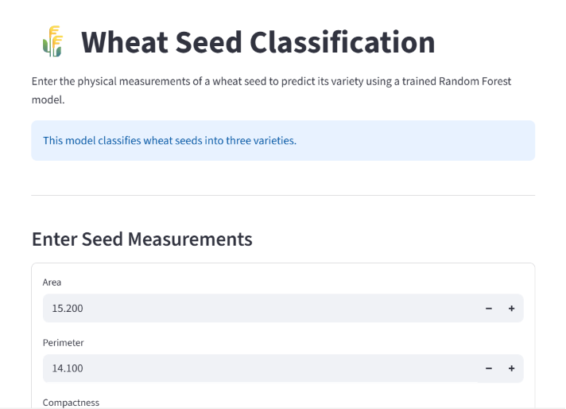
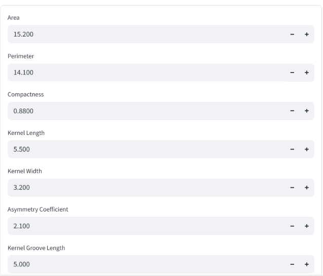
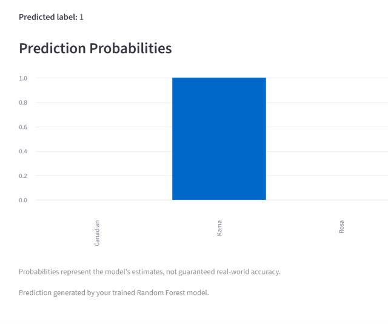

# 🌾 Wheat Seed Classification Using Machine Learning

<p align="center">
  
  
  
  
</p>

## 📌 Project Overview

This project uses machine learning to classify wheat seeds into three varieties: **Kama, Rosa, and Canadian**, based on their physical measurements.

The project includes a Jupyter Notebook for data analysis and model development, along with a Streamlit web application that allows users to enter seed measurements and receive a predicted variety.

## 🎯 Objectives

- Explore and analyze the wheat seed dataset.
- Perform data preprocessing and exploratory data analysis.
- Train and compare multiple machine learning algorithms.
- Improve model performance using cross-validation and hyperparameter tuning.
- Develop an interactive web application for wheat seed classification.

## 📊 Dataset

The dataset contains **210 samples**, seven input features, and one target variable.

**Input Features:**
1. Area
2. Perimeter
3. Compactness
4. Kernel Length
5. Kernel Width
6. Asymmetry Coefficient
7. Kernel Groove Length

**Target Classes:**
- Kama
- Rosa
- Canadian

Dataset file: `seeds.csv`

## 🧹 Data Preprocessing and Analysis

The Jupyter Notebook includes:

- Dataset loading using Pandas.
- Data inspection and exploration.
- Data preprocessing.
- Feature and target separation.
- Model training and evaluation.

## 🤖 Machine Learning Models

I experimented with three supervised machine learning algorithms:

**1. K-Nearest Neighbors (KNN)**

Classifies a sample based on its nearest data points.

**2. Decision Tree Classifier**

Uses feature-based decision rules to classify wheat seeds.

**3. Random Forest Classifier**

Combines multiple decision trees to produce a classification result.

### ⚙️ Model Optimization

- Stratified Cross-Validation
- GridSearchCV for hyperparameter tuning

## 📈 Model Performance

| Evaluation Metric | Accuracy |
|---|---:|
| Test Accuracy | 90.48% |
| Best Cross-Validation Accuracy | 92.25% |

## 🛠️ Technologies and Libraries Used

| Technology | Purpose |
|---|---|
| Python | Programming language |
| Pandas | Data manipulation |
| NumPy | Numerical operations |
| Scikit-learn | Machine learning |
| Matplotlib | Data visualization |
| Jupyter Notebook | Model development |
| Streamlit | Web application |
| Joblib | Model saving and loading, if used |

## 🖥️ Application Screenshots

### 🏠 Application Homepage



### 📥 Seed Measurement Inputs



### 📊 Prediction Probabilities



## 📁 Project Structure

```text
wheat-seed-classification/
│
├── 01_Improved_Wheat_Seed_Classification.ipynb
├── 1_Improved_Wheat_Seed_Classification.ipynb
├── app.py
├── seeds.csv
├── improved_wheat_seed_model.pkl
├── requirements.txt
├── README.md
│
├── Homepage.png
├── seed-inputs.png
└── prediction-probabilities.png
```

## 🚀 Installation and Setup

### 1. Clone the Repository

```bash
git clone https://github.com/NavyaRocky02/wheat-seed-classification.git
cd wheat-seed-classification
```

### 2. Create a Virtual Environment

```bash
python -m venv .venv
```

Activate on Windows:

```powershell
.venv\Scripts\activate
```

### 3. Install Dependencies

```bash
pip install -r requirements.txt
```

### 4. Run the Streamlit Application

```bash
streamlit run app.py
```

### 5. Open the Application

Open the local URL displayed in the terminal:

```text
http://localhost:8501
```

## 🔮 Future Improvements

- Add more model performance visualizations.
- Improve input validation and user experience.
- Compare additional machine learning algorithms.
- Deploy the application online.

## 📚 Learning Outcomes

- Data preprocessing and analysis.
- Exploratory Data Analysis.
- Feature engineering.
- Supervised machine learning.
- Model evaluation and optimization.
- Web application development using Streamlit.

## 📄 License

This project is developed for educational and learning purposes.
