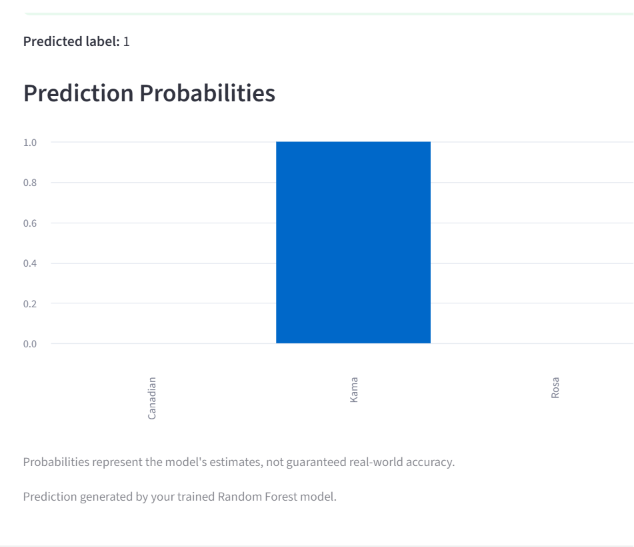

# 🌾 Wheat Seed Classification Using Machine Learning

<p align="center">
  
  
  
  
</p>

## 📌 Project Overview

This project uses machine learning to classify wheat seeds into three varieties: **Kama, Rosa, and Canadian**, based on their physical measurements.

It includes Jupyter Notebooks for data analysis, preprocessing, model development, and evaluation, along with an interactive Streamlit web application that allows users to enter seed measurements and receive a predicted variety.

## 🎯 Objectives

- Explore and analyze the wheat seed dataset.
- Perform data preprocessing and exploratory data analysis (EDA).
- Train and compare multiple machine learning algorithms.
- Improve model performance using cross-validation and hyperparameter tuning.
- Develop an interactive web application for wheat seed classification.

## 📊 Dataset

The project uses a wheat seed dataset containing **210 samples, seven input features, and one target variable**.

### Input Features

1. Area
2. Perimeter
3. Compactness
4. Kernel Length
5. Kernel Width
6. Asymmetry Coefficient
7. Kernel Groove Length

### Target Classes

- Kama
- Rosa
- Canadian

**Dataset file:** `seeds.csv`

## 📓 Jupyter Notebooks

This project includes two Jupyter Notebooks:

- **`1_Improved_Wheat_Seed_Classification.ipynb`** – Earlier implementation and experimentation.
- **`01_Improved_Wheat_Seed_Classification.ipynb`** – Updated implementation with model evaluation and improvements.

Both notebooks document the machine learning development process.

## 🧹 Data Preprocessing and Analysis

The notebooks cover the following steps:

- Loading the dataset using Pandas.
- Inspecting and exploring the dataset.
- Performing data preprocessing.
- Separating input features and target labels.
- Analyzing the data before model training.
- Training and evaluating machine learning models.

## 🤖 Machine Learning Models

I experimented with three supervised machine learning classification algorithms.

### 1. K-Nearest Neighbors (KNN)

Classifies a new sample based on the nearest data points.

### 2. Decision Tree Classifier

Uses feature-based decision rules to classify wheat seeds.

### 3. Random Forest Classifier

Combines multiple decision trees to produce a classification result. The trained Random Forest model is used in the Streamlit application.

## ⚙️ Model Optimization

The project uses the following techniques:

- **Stratified Cross-Validation:** Evaluates model performance while maintaining class proportions across folds.
- **GridSearchCV:** Searches for suitable hyperparameters to improve model performance.

## 📈 Model Performance

The reported evaluation results are:

| Evaluation Metric | Accuracy |
|---|---:|
| Test Accuracy | 90.48% |
| Best Cross-Validation Accuracy | 92.25% |

These values represent the results obtained during model evaluation in the notebook.

## 🛠️ Technologies and Libraries Used

| Technology / Library | Purpose |
|---|---|
| Python | Programming language |
| Pandas | Data manipulation and analysis |
| NumPy | Numerical operations |
| Scikit-learn | Machine learning and model evaluation |
| Matplotlib | Data visualization |
| Jupyter Notebook | Model development and experimentation |
| Streamlit | Interactive web application |
| Joblib | Model saving and loading |

## 🖥️ Streamlit Web Application

The project includes an interactive web application developed using Streamlit.

### Application Features

- Enter seven physical measurements of a wheat seed.
- Submit the measurements for classification.
- Predict the wheat seed variety using the trained Random Forest model.
- Display the predicted variety.
- Visualize the model's estimated prediction probabilities.

## 📸 Application Screenshots

### 🏠 1. Application Homepage

The homepage introduces the Wheat Seed Classification application and provides the seed measurement interface.


### 📥 2. Seed Measurement Inputs

Users can enter the seven physical measurements of a wheat seed.


### 🎯 3. Prediction Result

The application displays the predicted wheat seed variety after submitting the measurements.



### 📊 4. Prediction Probabilities

The application visualizes the estimated prediction probabilities for Kama, Rosa, and Canadian varieties.


## 📁 Project Structure

```text
wheat-seed-classification/
│
├── 01_Improved_Wheat_Seed_Classification.ipynb
├── 1_Improved_Wheat_Seed_Classification.ipynb
│
├── app.py
├── seeds.csv
├── improved_wheat_seed_model.pkl
├── requirements.txt
├── README.md
│
├── Homepage.png
├── seed-inputs.png
├── prediction-result.png
└── prediction-probabilities.png
```

## 🚀 Installation and Setup

### Prerequisites

- Python 3.x
- pip

### 1. Clone the Repository

```bash
git clone https://github.com/NavyaRocky02/wheat-seed-classification.git

cd wheat-seed-classification
```

### 2. Create a Virtual Environment

```bash
python -m venv .venv
```

Activate the environment on Windows:

```powershell
.venv\Scripts\activate
```

### 3. Install Dependencies

```bash
pip install -r requirements.txt
```

### 4. Run the Streamlit Application

```bash
streamlit run app.py
```

### 5. Open the Application

Open the local URL displayed in your terminal, usually:

```text
http://localhost:8501
```

**Note:** Make sure `improved_wheat_seed_model.pkl` is available at the file path expected by `app.py`.

## 🔮 Future Improvements

- Add more model performance visualizations.
- Improve input validation and user experience.
- Compare additional machine learning algorithms.
- Explore further model optimization techniques.
- Deploy the Streamlit application online.

## 📚 Learning Outcomes

Through this project, I gained practical experience in:

- Data preprocessing and analysis.
- Exploratory Data Analysis (EDA).
- Supervised machine learning.
- Classification algorithms.
- Cross-validation and hyperparameter tuning.
- Model evaluation and optimization.
- Building interactive applications using Streamlit.

## 📄 License

This project is developed for educational and learning purposes.
